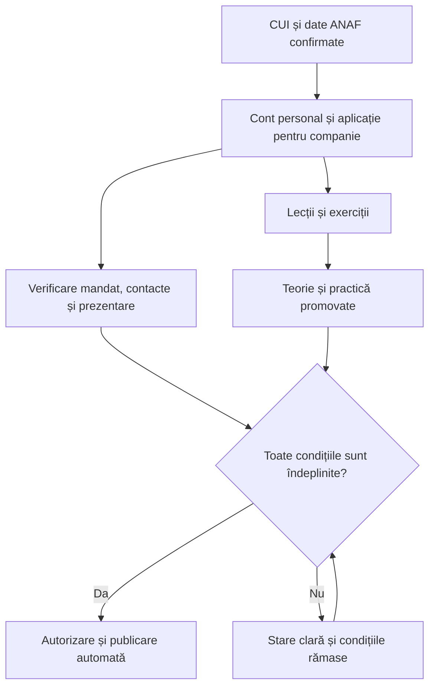

# Contribuitori, parteneri OpenAliment și programul de învățare

Plan de implementare și de conținut, 29 octombrie 2026. Bază inspectată: OpenAliment 0.9.0, `dev` la `0429d442a947e3f253e728eaec7dd12640270bc0`, migrări 001–011. Stadiu: propunere; documentul nu implementează funcții, nu acordă autorizări și nu modifică stagingul sau producția.

## 1. Rezultatul urmărit

Livrarea cuprinde două secțiuni publice și administrarea lor completă:

- **Contribuitori**: persoane care ajută proiectul prin cod, documentație, cercetare, UX, traduceri, testare, suport sau alte contribuții verificabile. Publicarea este voluntară și moderată.
- **Parteneri autorizați OpenAliment**: companii cu identitate și contacte verificate, reprezentate de persoane care au promovat pregătirea și evaluarea pentru competențele afișate.

Programul include înscriere cu ANAF, cursuri versionate, editor de lecții și întrebări, exerciții, examen, probe practice, evaluare, publicare, expirare, reînnoire, suspendare, schimbarea companiei, API, documentație și operații pe cPanel. Nu se reduce la două pagini statice sau la o etichetă după un quiz.

„Partener autorizat OpenAliment” descrie programul nostru și domeniul evaluat. Nu înseamnă acreditare GS1, reprezentant GS1, emitent de GTIN-uri, certificare alimentară ori garanție pentru orice ERP, imprimantă sau POS. Pagina de program va explica direct acest lucru, fără mesaje tehnice de dezvoltare.

Programul pornește pe dev cu starea **pilot**, în acord cu statutul actual al proiectului în formare. Publicarea comercială a programului cere completarea identității operatorului și a condițiilor sale; nu inventăm un ONG deja înființat. Pregătirea, simulările și testarea nu depind de înființarea ONG-ului.

## 2. Componente existente și reutilizare

| Componentă inspectată | Reutilizare și modificare necesară |
| --- | --- |
| `users`, `memberships`, `organizations`, `Accounts`, `Auth`, `ProducerSessions`, `Passkeys` | Un cont personal, apartenențe distincte. Nu creăm un al doilea sistem de parole și nu acordăm rol de administrator prin înscrierea în program. |
| `OrganizationRegistry`, `AnafClient`, `AnafPresentation`, migrarea 011 | Același transport ANAF v9, cache, limitare, verificări legate de sesiune și observații originale. Profilul unei firme nu își schimbă CUI-ul în loc. |
| `Marketplace` și `008_marketplace.sql` | Ofertele software au deja ciornă, aprobare și istoric. Parteneriatul este o calificare separată, nu o aprobare automată a produselor software. |
| `DigitalLink`, `Resolver*`, `Printing`, `PartnerMapping` | Se folosesc validatoarele și contractele existente în exerciții; `PartnerMapping` este maparea de integrare ERP, nu registrul noilor parteneri. |
| `contracts/gs1/standards-catalog.json`, `/standarde/gs1` | Referințe normative fixate prin ediție și hash; programul nu își inventează o variantă GS1. |
| `DocumentBlobs`, `DocumentScanner`, `HomePhotos` | Se reutilizează mecanismele potrivite de stocare și validare, nu permisiunile fotografiilor personale sau documentele unui produs fictiv. Un logo are propria politică de procesare. |
| `Mailer`, PHPMailer, `security_outbox`, `tools/worker.php`, `Maintenance` | Același transport SMTP și aceleași principii de joburi limitate. Mesajele de curs nu se amestecă în outboxul de incidente de securitate. |
| `ApiRoutes`, generatoarele OpenAPI/Markdown/Postman/AI, `Api::mutation` | Orice acțiune nouă a utilizatorului sau a evaluatorului are contract și probă HTTP. Rutele vechi rămân compatibile. |
| `Portability`, `TransferStream`, backup/restore | Exportăm progresul și dosarele potrivite destinatarului. Importul nu acordă calificări, autorizări sau mandate. |

Nu modificăm nucleul resolverului pentru a introduce în el parteneri, cursuri ori certificate. Scanarea unui produs nu va interoga cursurile, ANAF sau serviciul AI.

## 3. Ce verificăm și ce publicăm

### 3.1 Identitate fiscală versus contact

Serviciul ANAF v9 consultat furnizează nume, CUI, date fiscale, telefon/fax și adrese, dar **nu furnizează email**. Referință: [schema oficială ANAF v9](https://static.anaf.ro/static/10/Anaf/Informatii_R/Servicii_web/doc_WS_V9.txt).

| Informație | Autoritate și regulă |
| --- | --- |
| CUI, țară, denumire legală, număr de registru, stare fiscală | Din observația ANAF confirmată; readonly în formularul de prezentare. Se păstrează data, ediția și proveniența. |
| Telefon din ANAF | Păstrat ca telefon fiscal din sursă. Nu dovedește că persoana care se înscrie controlează numărul și nu este publicat automat. |
| Email public al companiei | Furnizat de companie, verificat separat prin legătură de confirmare și aprobat pentru publicare. Nu primește eticheta „din ANAF”. |
| Telefon comercial public | Opțional; verificat separat, prin procedură manuală auditată în prima livrare. Adaptorul SMS rămâne o interfață extensibilă, fără a presupune un furnizor existent. |
| Reprezentarea companiei | Verificare separată de un evaluator autorizat, cu probe private. Simpla cunoaștere a CUI-ului nu acordă mandat. |
| Logo, servicii, site, zone deservite, limbi | Declarații ale companiei, cu drepturi confirmate și moderare. Site-ul este un URL HTTPS valid; nu este executat sau accesat automat de server. |
| Competențe și autorizare | Din evaluările și deciziile programului. Compania nu își poate scrie singură calificativele sau perioada de valabilitate. |

Sursele și etichetele rămân explicite: „Date fiscale ANAF, consultate la…” și „Contact confirmat de companie”. Nu prezentăm date fiscale complete, documente de mandat, rezultatele individuale sau emailul personal ca informații publice implicit.

### 3.2 Condițiile de publicare

O companie apare în lista activă numai dacă sunt simultan adevărate:

1. Identitatea fiscală are o observație directă ANAF confirmată și suficient de recentă.
2. Reprezentarea și afilierea responsabilului sunt verificate.
3. Există email public verificat și acord explicit pentru câmpurile publice; telefonul este opțional.
4. Există cel puțin o persoană afiliată, activă, cu calificare valabilă pentru specializarea afișată.
5. Probele teoretice și practice cerute de politica ediției sunt promovate.
6. Prezentarea publică este aprobată și există drepturi pentru imaginile folosite.
7. Autorizarea pentru acea companie și specializare este activă, neexpirată și nesuspendată.

Verificarea dosarului și a prezentării se poate face în paralel cu învățarea, înainte de examen. Când ultima condiție este îndeplinită, publicarea se face automat, tranzacțional. Nu mai cerem un buton inutil „publică” după promovare. Dacă verificarea mandatului nu s-a terminat, candidatul vede „Test promovat. Datele companiei sunt în verificare”; nu afișăm prematur firma ca autorizată.

Starea fiscală inactivă/radiată blochează emiterea unei noi autorizări până la clarificare; nu șterge progresul și nu interzice accesul la curs. Datele absente nu devin „activ”. O indisponibilitate ANAF nu devine o declarație despre statutul companiei.

Parametri propuși: verificare fiscală de cel mult 30 de zile la emitere/reînnoire; reverificare lunară eșalonată a partenerilor activi. La indisponibilitatea sursei, o autorizare încă valabilă își poate păstra statutul cel mult 7 zile după termenul de reverificare, cu data ultimei verificări vizibilă. După aceea se suspendă cu motivul „date de reconfirmat”. Retragerea mandatului sau revocarea unei calificări nu beneficiază de această perioadă.

## 4. Fluxuri și UX

### 4.1 Contribuitori

Pagina `/contribuitori` are o introducere scurtă, categorii de contribuție, căutare și carduri uniforme. Ordinea implicită este alfabetică; nu folosim numărul de commituri ca măsură a valorii persoanei. Un card poate avea nume sau pseudonim, avatar opțional, contribuții, legături aprobate și perioada implicării.

Administratorul poate propune un profil și păstra dovezile contribuțiilor în privat. Publicarea cere acordul persoanei, înregistrat printr-o invitație limitată sau prin confirmare auditată. Conturile existente își pot propune/actualiza profilul; nu cerem CUI pentru recunoașterea unei contribuții. Nu obligăm un contribuitor fără cont să își inventeze o firmă.

Actualizările intră în ciornă; versiunea aprobată rămâne publică. Retragerea acordului scoate profilul din listă și din sitemap. GitHub poate furniza opțional propuneri de atribuiri cu proveniență, dar nu publică automat persoane, adrese de email sau date extrase din commituri. Nu există dependență de GitHub pentru randarea paginii.

Un profil de contribuitor nu acordă acces la hosting, administrare, date de producători sau statut de partener. Participarea într-o firmă parteneră nu acordă automat credit de contribuitor.

Lista voluntară de persoane este separată de mențiunile de autor cerute de licențele codului și resurselor. Retragerea unui profil public nu șterge automat istoricul Git sau notificările de licență care trebuie păstrate.

### 4.2 Înscrierea companiei

Traseu principal:

`/parteneri` → „Devino partener” → CUI + OK → date ANAF și corectare → cont personal/folosirea contului existent → pregătire și dosar în paralel → evaluare → publicare când toate verificările sunt îndeplinite.

Se reutilizează componentele înregistrării ANAF, fără copierea clientului de rețea. Contextul de înscriere este păstrat pe server și nu constituie o permisiune. După conectare sau MFA, revenirea folosește numai destinații interne dintr-o listă permisă, nu un URL arbitrar primit de la client.

Un utilizator deja autentificat poate iniția aplicația pentru organizația curentă sau pentru altă firmă verificată. Nu este obligat să creeze alt email/alt cont. Dacă firma este deja în program, se solicită acces verificat la profilul existent; CUI-ul identic nu produce acces automat la organizația ori datele ei de producător.

Datele profilului se cer în pași mici: firma, contactele, serviciile. Un singur buton principal pe pas, salvare automată unde este sigură, etichete vizibile, erori lângă câmp și reluare din locul salvat. Logo-ul este opțional, nu blochează începerea cursului.

### 4.3 Persoanele și învățarea

Calificarea aparține persoanei, nu unei parole comune a companiei. Responsabilul poate invita colegi cu conturi individuale. Invitația acordă numai accesul explicit la program; nu acordă automat acces la rețete, ERP, API-uri de producător sau administrarea firmei.

`users` poate exista independent de `memberships`. Pentru persoanele invitate fără organizație de producător se introduce un traseu de cont pentru învățare: conectarea ajunge la `/invatare/cont`, nu eșuează la `/manage`. Verificarea parolei, recuperarea și cheile de acces trebuie să funcționeze și pentru acești utilizatori, fără a fabrica un tenant. Fluxurile actuale ale producătorilor își păstrează destinațiile și regulile de securitate.

Lectura lecțiilor publice nu cere cont. Contul este necesar pentru progres salvat, evaluare și calificare. Se reutilizează sesiunile valide și cheile de acces existente; nu schimbăm implicit durata tuturor sesiunilor platformei. După întrerupere, „Continuă cursul” duce direct la lecția salvată.

Lecția prezintă pe scurt obiectivul, explicația, un exemplu, un exercițiu și butonul „Continuă”. Este utilizabilă fără video, cu tastatura, pe telefon și cu cititor de ecran. Nu impunem minute artificiale de vizionare, scroll până la capăt sau zece confirmări administrative. Exercițiile sunt verificarea înțelegerii.

### 4.4 Pagina publică de parteneri

`/parteneri` are căutare după nume/serviciu/localitate, filtre de specializare și lucru la distanță. Cardul arată logo, numele legal, competențele autorizate, zona și „Vezi partenerul”.

`/parteneri/{slug}-{id}` arată CUI, contactele aprobate, serviciile, specializările exacte, emitentul OpenAliment, ediția criteriilor, valabilitatea și legătura de verificare. Datele persoanelor calificate sunt publice numai cu acordul lor; altfel se afișează competența și existența responsabililor calificați.

O ofertă comercială nu poate ascunde sau prelungi statutul autorizării. Nu afișăm evaluări inventate, certificări GS1 neacordate sau compatibilități cu echipamente neprobate. Legăturile externe de servicii nu influențează resolverul alimentelor.

### 4.5 Schimbarea CUI-ului sau a companiei

Înainte de confirmare, CUI-ul poate fi corectat liber, cu invalidarea verificării vechi, ca în fluxul actual. După creare, „Schimbă compania” este un transfer controlat al afilierii persoanei:

1. Persoana consultă noul CUI și confirmă datele ANAF.
2. Se creează sau se selectează prin verificare noua organizație/aplicație; se verifică noul mandat și noile contacte.
3. Progresul și calificările personale încă valabile se păstrează. Nu se transferă drepturi asupra datelor vechii firme.
4. Noua companie primește propria autorizare, dacă îndeplinește toate condițiile. Nu moștenește automat aprobarea vechii companii.
5. Afilierea veche este încheiată explicit; dacă pleacă ultimul responsabil calificat, autorizarea aferentă se suspendă imediat. Dacă rămân alți responsabili eligibili, compania veche își poate păstra statutul.
6. Numele, CUI-ul și URL-ul vechii companii nu sunt rescrise și nu sunt redirecționate spre o altă persoană juridică. Contactele, logo-ul, produsele, loturile, mandatele GS1 și cheile API nu se copiază automat.

Această operație nu modifică `organization_legal_profiles.cui` și nu schimbă retroactiv certificate, factori de evaluare sau informații ale loturilor. Schimbarea denumirii la același CUI folosește o nouă versiune ANAF și o nouă proiecție publică, cu istoric.

## 5. Cursul: structură și obiective

Programul inițial are un nucleu comun și specializări. Estimare pedagogică: 4–6 ore pentru nucleu, inclusiv exerciții, în ritm propriu; 1–3 ore suplimentare pentru specializarea aleasă. Acestea nu sunt timpi obligatorii măsurați prin supraveghere.

Referințele normative fixate sunt [URI Syntax 1.7.0](https://ref.gs1.org/standards/digital-link/uri-syntax/1.7.0/), [Resolver 1.2.1](https://ref.gs1.org/standards/resolver/1.2.1/), [General Specifications 26.0.0](https://ref.gs1.org/standards/genspecs/26.0.0/) și catalogul local. Publicăm explicații și exerciții proprii, cu trimiteri la ediții/secțiuni; nu republicăm PDF-urile GS1 ca material MIT al proiectului.

### 5.1 Nucleul comun

| Modul | Ce trebuie să poată demonstra cursantul | Activitate practică |
| --- | --- | --- |
| M01. OpenAliment și limitele autorizării | Distinge găzduirea QR, documentația voluntară, sigla alimentară, parteneriatul și verificarea firmei. | Clasifică cinci afirmații comerciale corecte sau înșelătoare. |
| M02. Identificarea produsului | Distinge articolul, GTIN-ul, lotul și ambalajul serializat; verifică dreptul de administrare separat de sintaxă. | Identifică ce informație lipsește unui cod generic de produs pentru a numi un lot. |
| M03. Citirea unei adrese Digital Link | Separă domeniul, cheia primară, calificatorii și atributele; înțelege profilul GTIN al platformei. | Explică o adresă de produs, una de lot și una cu serie, fără să modifice identificatorii. |
| M04. Codificare și caractere | Păstrează valorile, zerourile și majusculele; evită dubla codificare și folosirea regulilor de formular pentru segmente de URL. | Recuperează exact lotul `LOT/A+B%1` dintr-un segment codificat și identifică o dublă codificare greșită. |
| M05. Resolver și pagină web | Distinge sintaxa URI de funcțiile resolverului și profilul declarat de o promisiune de compatibilitate generală. | Citește descriptorul și un linkset în laborator; explică de ce un redirect simplu nu probează toate funcțiile. |
| M06. Produs, etichetă și lot | Leagă lotul de versiunea informațiilor publicabile; rețeta poate lipsi sau poate fi privată. | Corectează o etichetă fără să rescrie istoricul lotului vechi; verifică alerta curentă. |
| M07. Date publice, proveniență și licențe | Separă informațiile ANAF/OFF, declarațiile producătorului și documentele licențiate explicit. | Respinge publicarea unei rețete private și nu transformă o estimare din pilot în rezultat validat. |
| M08. API și integrare | Citește OpenAPI, folosește autentificarea potrivită, paginarea, cheile idempotente și controlul versiunilor. | Simulează crearea unui produs și lot fără rețetă, apoi un retry și un conflict. |
| M09. Tipărire și serializare | Distinge identificatorul unic per ambalaj de formatul trimis imprimantei; înțelege reimprimarea și confirmările. | Pregătește un job JSON/ZPL în laborator și explică ce confirmă efectiv un ACK. |
| M10. Securitate și operare | Aplică acces minim, izolarea între companii, revocarea cheilor, gestionarea erorilor și continuitatea fără AI. | Arată că un token de citire nu poate publica sau modifica datele altei firme. |
| M11. Incidente și portabilitate | Tratează un lot problematic, o cheie compromisă, exportul/migrarea și păstrarea adreselor tipărite. | Propune ordinea măsurilor pentru o alertă și pentru mutarea la alt furnizor. |
| M12. Responsabilitatea partenerului | Prezintă corect serviciul, limitele probelor, suportul și calificarea; știe când are nevoie de o probă fizică. | Corectează oferta „merge garantat pe orice casă de marcat”. |

Fiecare modul are 2–4 lecții scurte, un exemplu vizual SVG, un rezumat de maximum câteva idei și 2–4 întrebări formative cu explicații. Exemplele nu sunt adevărate doar pentru pâine: folosim Pâine Bună Tehnic, un aliment din altă categorie fără rețetă și un conector generic.

### 5.2 Specializări publicabile distinct

| Cod propus | Pregătire suplimentară | Proba de autorizare |
| --- | --- | --- |
| `erp-integration` | ERP/PIM, mapare, import, revizii, retry, jurnale și revocare. | Conector simulat, două evenimente duplicate, conflict și export coerent. |
| `printing-integration` | Dispozitiv/agent, URL în QR, rezervare de serii, JSON/ZPL, reimprimare și controlul lotului. | Job serializat verificat și probă de tipărire documentată. Scanarea software singură nu acordă acest nivel complet. |
| `platform-operations` | Domenii, descriptor, resolver, aprobări, incidente, backup/restore și monitorizare. | Diagnostic pe laborator și procedură de restaurare probată pe date sintetice. |
| `product-data` | Date publicabile, etichete și loturi, proveniență OFF/ANAF, licențe și integrarea comercială corectă. | Dosar de produs/lot fără rețetă, cu publicare corectă și istoric. Nu conferă autoritate medicală sau certificare alimentară. |

Orice specializare cere nucleul comun. Profilul public arată exact specializările promovate; un curs introductiv parcurs nu este echivalent cu autorizarea tuturor serviciilor. Extinderea la alte competențe folosește același motor și o nouă politică explicită.

## 6. Frameworkul pentru lecții, documentație și întrebări

### 6.1 Editare și publicare

Editorul administrativ gestionează curs → module ordonate → lecții → resurse și exerciții. O lecție are ID stabil, titlu, obiective, text Markdown sigur, exemple, resurse aprobate, dependențe, limbă, durată orientativă și referințe normative. Nu acceptăm HTML/JavaScript arbitrar sau cod executabil încărcat în lecție.

Fluxul conținutului: `draft → review → published → retired`. O ediție publicată este imuabilă. Corectarea produce o nouă ediție, cu autor, evaluator, rezumatul schimbărilor, licență explicită și hash. Autorul alege drepturile materialelor proprii; propunerea pentru lecțiile deschise este CC BY 4.0. Materialele GS1 și alte resurse externe își păstrează drepturile.

Editorul de întrebări gestionează: ID stabil, domeniu de competență, tip, enunț, variante, regulă de punctare, nivel critic, explicație pentru exerciții, referință la lecție/standard, limbă și stare. Variantele publice și explicațiile formative sunt distincte de banca examenului.

Tipurile inițiale sunt alegere unică, alegere multiplă, asociere și identificarea structurii unui URI; răspunsul liber este rezervat probelor cu rubrică umană. Nu adăugăm un LMS extern, un constructor HTML general sau un limbaj arbitrar de evaluare.

Importul/exportul editorului folosește JSON versionat, cu validare, limite și previzualizarea diferențelor. Importul nu publică direct; nu execută scripturi și nu descarcă URL-uri. Formatele și exemplele sintetice sunt în GitHub. Banca sumativă reală și cheile de corectare se păstrează în date private ale instalării, nu în repository sau în pachetul public cPanel.

### 6.2 Versionare și progres

Ediția cursului conține manifestul ordonat al lecțiilor și resurselor. Ediția examenului fixează banca, distribuția întrebărilor, pragurile și rubricile. Înscrierea și tentativa trimit la aceste ediții, nu la un conținut care se schimbă în timpul testului.

Actualizările editoriale minore pot transfera progresul numai printr-o mapare explicită între ID-uri de lecție. Schimbările normative importante pot cere un modul de actualizare și o reevaluare definită; nu ștergem progresul și nu recalculăm retroactiv calificări fără o procedură auditată.

La detectarea unei întrebări greșite, oprirea ei pentru tentative viitoare este separată de reevaluarea celor afectate. Rezultatul vechi și decizia corectată rămân în istoric; nu modificăm în tăcere baremul unui examen deja predat.

## 7. Planul de evaluare

### 7.1 Politica inițială propusă

- Banca inițială are minimum **100 de întrebări revizuite**, acoperind toate domeniile și suficiente variante pentru întrebările critice; plus exercițiile formative publice. Nu publicăm un examen cu numai cele câteva exemple din acest plan.
- Examenul comun are **30 de întrebări**, selectate după o distribuție fixată în politică, nu aleator din întreaga bancă fără acoperire.
- Sunt prevăzute **45 de minute**, cu adaptări de accesibilitate aprobate înainte de începere. Cursurile și standardele sunt consultabile: evaluăm aplicarea lor, nu memorarea unor numere de paragraf.
- Promovare: **minimum 85% ponderat**, minimum 70% în fiecare domeniu și toate cele 6 verificări critice corecte. O greșeală critică nu se compensează prin întrebări ușoare.
- Probele practice comune și ale specializării cer minimum 85/100 și toate condițiile obligatorii din rubrică. Sunt necesare atât teoria, cât și practica.
- Reîncercare după minimum 24 de ore, maximum 3 tentative în 7 zile; apoi se stabilește cu evaluatorul ce pregătire mai este necesară. Parametrii sunt configurați prin ediție, nu fixați în JavaScript.
- Calificarea și autorizarea sunt propuse cu valabilitate de 12 luni. Reînnoirea include verificarea afilierii și firmei, actualizările de curs și reevaluarea cerută de politica curentă.

| Domeniu teoretic | Întrebări | Pondere |
| --- | ---: | ---: |
| Identitate, drepturi și delimitarea serviciilor | 6 | 20% |
| Structura URI și codificarea valorilor | 6 | 20% |
| Resolver și profilul implementat | 6 | 20% |
| Date publicabile, istoric și proveniență | 4 | 15% |
| API și integrare | 4 | 15% |
| Operare, tipărire și limitele probelor | 4 | 10% |
| **Total** | **30** | **100%** |

Punctajul se normalizează în interiorul domeniului, apoi se aplică ponderile; nu presupunem că toate întrebările au aceeași greutate. Politica și precizia calculului sunt fixate în tentativa salvată.

În ediția inițială, o întrebare sumativă se punctează integral sau cu zero: la alegere multiplă trebuie selectat exact setul corect, iar la asociere/structură trebuie rezolvate toate componentele cerute. Omisiunile primesc zero; nu există penalizări negative sau evaluare semantică făcută de AI. Exercițiile formative pot explica separat componentele greșite. Pragurile se compară prin calcul exact, înainte de rotunjirea pentru afișare; un rezultat sub 85% nu este promovat prin rotunjire.

### 7.2 Exemple de întrebări pentru proiectarea băncii

Acestea sunt repere de conținut și răspuns așteptat, nu banca secretă de producție.

| Nr. | Situație | Ce demonstrează răspunsul corect |
| --- | --- | --- |
| Q01 — critic | „Am introdus un GTIN cu cifră de control validă; pot administra produsul?” | Sintaxa nu dovedește mandatul. |
| Q02 | Un singur QR generic este pus pe toate ambalajele, fără lot în adresă. | Identifică produsul; nu afirmăm că știm lotul scanat. |
| Q03 | Două ambalaje au același GTIN și lot, dar serii diferite. | Sunt unități serializate diferite în aceeași familie. |
| Q04 | Identificatorul are zerouri inițiale. | Se păstrează forma și regulile identificatorului; nu se convertește arbitrar în număr. |
| Q05 | Cine controlează domeniul din adresa tipărită? | Continuitatea domeniului și serviciului este distinctă de drepturile asupra GTIN-ului. |
| Q06 | Firma apare în ANAF. | Nu rezultă automat mandat, siglă sau certificare GS1. |
| Q07 | Separă componentele unui URI de lot cu serie și date. | Identifică domeniul, 01, 10, 21 și atributele informative. |
| Q08 — critic | Lotul este `LOT/A+B%1`. | Codificare pe valoare și decodificare o singură dată; plusul nu devine spațiu. |
| Q09 | Un partener propune să înlocuiască slashul din lot cu liniuță. | Nu schimbă identificatorul pentru a ocoli infrastructura. |
| Q10 | Se schimbă data din query pentru un lot vechi. | Cererea nu rescrie informația aprobată a lotului. |
| Q11 | Un sistem oferă o simplă pagină la o adresă Digital Link. | Nu presupune automat că implementează un resolver complet. |
| Q12 — critic | „Resolverul nostru declară cheia 01; deci suportă orice cheie GS1.” | Citește profilul și refuză afirmația generală neprobată. |
| Q13 | URI valid, dar obiect necunoscut; alt URI este invalid. | Distinge lipsa resursei de eroarea de structură în probele resolverului. |
| Q14 | Clientul cere un tip de legătură/language și primește altă destinație. | Verifică metadatele, selecția și linksetul după profil și standard. |
| Q15 — critic | Un producător nu vrea să încarce rețeta. | Poate avea produs/lot/QR; rețeta nu devine obligatorie sau publică. |
| Q16 | Eticheta actuală se schimbă, dar există loturi vechi. | Versiuni istorice și alerte curente, nu înlocuirea retroactivă. |
| Q17 | OFF și producătorul au informații diferite. | Păstrează proveniența și aprobările; nu suprascrie automat. |
| Q18 | CUI negăsit versus ANAF indisponibil. | Rezultate distincte; nu completează date presupuse. |
| Q19 — critic | Un conector cere tokenul global de administrator. | Folosește delegare minimă; verifică izolarea între organizații și revocarea. |
| Q20 | ERP retrimite evenimentul după timeout. | Retry idempotent; nu creează un lot sau o serie nouă din greșeală. |
| Q21 | Apare un conflict de versiune la actualizare. | Citește, compară și reconfirmă; nu forțează suprascrierea. |
| Q22 | Agentul a confirmat primirea unui job. | ACK-ul software nu este proba tipăririi fizice. |
| Q23 — critic | Un telefon citește QR-ul de pe ecran. | Nu dovedește funcționarea pe orice ambalaj, imprimantă sau POS. |
| Q24 | Compania pierde ultimul responsabil calificat. | Statutul public se reevaluează; calificarea personală nu ține firma autorizată fără afiliere validă. |

### 7.3 Laboratorul și probele practice

Laboratorul este o simulare separată, limitată, care folosește validatoarele și contractele platformei. Nu scrie în registrul GTIN, produsele, loturile, joburile de tipărire sau inventarele utilizatorilor reali. Nu primește chei de producție și nu execută cod încărcat de candidat.

| Probă | Sarcina candidatului | Criterii obligatorii |
| --- | --- | --- |
| P01 — comună | Construiește și explică URI-urile pentru produs, lot și unitate, pornind de la pilotul Pâine Bună Tehnic. | Identități distincte, valori intacte, adresă persistentă, caracter demonstrativ explicit. |
| P02 — comună | Introduce un aliment din altă categorie, fără rețetă, publică versiunea corectă și lotul; simulează o alertă și o actualizare ulterioară. | Fără licență/siglă automată, lotul vechi păstrează eticheta, alerta rămâne vizibilă, AI indisponibil nu blochează pagina. |
| P03 — ERP | Mapează date sintetice și tratează retry, conflict, acces refuzat și export. | Fără duplicate, fără ocolirea aprobărilor, fără scurgere între două organizații simulate. |
| P04 — tipărire | Pregătește 10 serii unice și jobul JSON/ZPL; cere o reimprimare justificată. | URL complet, serie/lot corecte, reimprimare urmărită, lipsa unei confirmări fizice nu devine succes. |
| P05 — operare | Citește descriptor/linkset, diagnostichează o selecție greșită și restaurează un set sintetic. | Păstrează identitățile și istoricul; explică exact ce profil și probe au trecut. |
| P06 — date | Pregătește dosarul publicabil și o schimbare de companie simulată. | Proveniență, date private excluse, CUI vechi nemodificat, nou mandat, contacte reverificate. |

Rubrică de bază: corectitudinea identităților 25p, păstrarea datelor/istoricului 25p, securitate și erori 25p, explicarea și evidența rezultatului 25p. Fiecare specializare detaliază criteriile înaintea înscrierii. Automatizăm verificările deterministe; un evaluator validează explicațiile și probele fizice. Nu folosim AI ca arbitru final.

Pentru specializarea de tipărire, o fotografie și un raport al echipamentului sunt probe declarate și revizuite, nu o certificare independentă a tuturor caselor de marcat. Dacă proba fizică lipsește, rezultatul indică nivelul de laborator și nu se publică specializarea completă de tipărire.

### 7.4 Integritatea evaluării

Selecția, amestecarea variantelor și termenul sunt generate pe server cu sursă criptografică de aleator. O singură tentativă activă per persoană și ediție relevantă. Clientul nu primește cheia de corectare, raționamentele sumative ascunse sau întregul pool privat.

Răspunsurile se salvează cu număr de revizie; taburile concurente nu se suprascriu în tăcere. Butonul final este idempotent, iar predarea repetată produce același rezultat. Termenul se verifică pe server inclusiv la reconectare. Workerul poate închide tentativele expirate, dar lipsa lui nu permite răspunsuri întârziate.

Înaintea predării se arată întrebările fără răspuns. La întreruperea rețelei, pagina indică ce nu s-a salvat; nu afișează succes fictiv. Adaptările pentru accesibilitate sunt documentate, fără supraveghere biometrică sau webcam obligatoriu.

După eșec se oferă punctaj pe domenii și lecții de reluat. Exercițiile formative explică complet răspunsurile; examenul nu expune imediat toate cheile reutilizabile. Nu promitem că un examen online fără supraveghere fizică dovedește identitatea absolută sau împiedică orice ajutor extern. Limita se compensează prin cont personal, probe practice și validarea dosarului, cu descrierea exactă a nivelului evaluat.

## 8. Calificări, autorizări și întreținerea statutului

**Calificarea personală** indică persoana, cursul/ediția, domeniul, rezultatul eligibil, emiterea, expirarea și eventuala revocare. **Autorizarea companiei** leagă o companie verificată de specializările și responsabilii eligibili. Niciuna nu este sigla pentru documentația unui aliment.

Stări principale:

- Aplicație: `draft → submitted → in_review → eligible / needs_changes / rejected / withdrawn`.
- Tentativă: `in_progress → submitted / timed_out → graded`; o anulare sau corectare are motiv și istoric.
- Calificare: `active → expired / revoked`, cu eventuală înlocuire printr-o nouă calificare.
- Autorizare: `pending → active → suspended / expired / revoked`; reactivarea este o decizie nouă justificată.
- Prezentare publică: `draft → submitted → approved`; publicarea efectivă mai cere eligibilitatea curentă.

Eligibilitatea publică se verifică la citire, nu doar printr-un câmp recalculat noaptea. Revocarea, expirarea sau plecarea ultimului responsabil calificat elimină imediat eticheta activă. Joburile trimit notificări și pregătesc proiecții, dar nu sunt singura apărare împotriva unui statut fals.

Se oferă certificat HTML imprimabil și JSON de calificare, cu ID opac și URL `/verificare/parteneri/{public_id}`. QR-ul certificatului este o legătură web a programului; nu primește un GTIN și nu este prezentat drept GS1 Digital Link de produs. Verificarea online afișează starea curentă; un PDF/imagine veche nu poate confirma singur valabilitatea.

Participanții pot cere reevaluarea unui rezultat sau a unei suspendări. Evaluatorul nu își aprobă propria tentativă/companie; decizia, motivul și dovezile sunt păstrate separat de prezentarea publică. Corecțiile nu șterg rezultatul anterior.

## 9. Modelul de date propus

Se păstrează tabelele existente și se adaugă următoarele grupuri. Coloanele comune sunt ID-uri opace, timpi UTC, actori, revizie și indici pentru interogările folosite. Afișarea folosește `Europe/Bucharest`. JSON-urile sunt contracte validate, nu câmpuri arbitrare pentru permisiuni.

| Tabel nou | Conținut și constrângeri principale |
| --- | --- |
| `program_staff_grants` | Roluri limitate de editor/evaluator/reviewer, acordate numai de administrator; utilizator, scope, stare și istoric prin evenimente. |
| `program_events` | Audit append-only pentru publicări, acorduri, evaluări și autorizări; referințe și hashuri, fără tokenuri sau chei de corectare în loguri. |
| `program_assets` | Avatare, logo-uri și resurse: proprietar/context, cheie privată, MIME real, dimensiuni, hash, proveniență, procesare și aprobare. |
| `program_jobs` | Coada limitată de notificări și operații ale programului; tipuri permise, referințe, retry, lease și cheie unică de deduplicare. |
| `contributor_profiles` | Utilizator opțional sau identitate curată de recunoaștere; slug, ciornă, proiecție aprobată, revizie și starea acordului. Nu constituie un cont de acces. |
| `learning_courses` | Identitate stabilă a cursului, ciornă, revizie și ediție publicată curentă. |
| `learning_releases` | Manifest imuabil de module/lecții/resurse, licență, referințe normative, hash și decizii de publicare. |
| `learning_enrollments` | Persoană + ediție + traseu/specializare, început, stare, reluare și ediție acceptată a politicii. |
| `learning_progress` | Înscriere + lesson ID stabil, exercițiu, ultima poziție și revizie; unicitatea împiedică dublarea progresului. |
| `assessment_banks` | Ciornă privată de întrebări și rubrici, cu editor și control de revizie. |
| `assessment_releases` | Banca și politica imuabile: întrebări versionate, răspunsuri private, distribuție, praguri și rubrici. |
| `assessment_attempts` | Persoană, înscriere, ediție, început/termen, stare și cheie de predare idempotentă. |
| `assessment_items` | Selecția și ordinea servită, mapa variantelor, răspunsul candidatului, revizia salvării. Nu este un DTO public cu chei de corectare. |
| `assessment_results` | Rezultate versionate, punctaj pe domenii/criterii, evaluator, justificare, decizii de reevaluare. |
| `assessment_lab_runs` | Stare virtuală limitată, scenariu și evidența probelor; nu sunt produse sau loturi reale. |
| `learning_credentials` | Calificări per persoană, specializare, ediție, rezultat, valabilitate, revocare și vizibilitate. |
| `partner_applications` | Aplicație pentru companie/program, solicitant, versiune fiscală, ciornă de prezentare, verificări și decizii. Aplicațiile nevalidate nu rezervă public un CUI. |
| `partner_profiles` | Identitatea stabilă a companiei în program, tenant fix, CUI/țară, slug și versiunea aprobată curentă. |
| `partner_profile_versions` | Snapshoturi publicabile și aprobări imuabile: versiune fiscală, contacte aprobate, logo, servicii și drepturi. |
| `partner_affiliations` | Persoană ↔ companie/program, rol limitat, mandat, început/sfârșit și verificare. Nu acordă implicit `memberships` de producător. |
| `partner_contacts` | Contact normalizat, companie, tip, proveniență, confirmare, expirare și acord de publicare. Schimbarea valorii invalidează confirmarea veche. |
| `program_verifications` | Dovezi și provocări cu scop explicit: acord contributor, invitație, email, telefon, mandat, schimbare de afiliere; tokenuri doar hash, termen și consum unic. |
| `partner_authorizations` | Companie + specializare + politica/calificările dovedite, interval, stare, emitent și motive de suspendare/revocare. |

Număr orientativ: **23 de tabele**, pentru entități cu durate, permisiuni și istoric diferite. Nu adăugăm tabele pentru fiecare paragraf sau variantă de răspuns: manifestele de curs și bancă sunt JSON imuabil, iar progresul/tentativele sunt relaționale. Schema finală se confirmă la implementare prin interogările și testele reale.

Reguli de integritate:

- FK-uri și verificări compuse între companie, profil, versiune și afiliere; ID-ul unui obiect nu autorizează accesul.
- O singură intrare verificată pentru `(țară, CUI, program)`; rezervarea are loc după verificarea mandatului, nu la prima interogare ANAF. Dublurile intră în reconciliere, fără acces automat la tenantul existent.
- Nicio unicitate nouă globală pe `organizations.cui`; nu schimbăm protecția împotriva ocupării abuzive a unei firme printr-un cont neverificat.
- Imutabilitate pentru ediții, rezultate și autorizări istorice; schimbările de stare au actor, motiv și eveniment.
- Publicarea și retragerea folosesc tranzacții scurte și blocare pe profil; nici ANAF, SMTP, nici procesarea imaginii nu stau într-o tranzacție SQL lungă.

Observațiile ANAF ale programului trebuie să poată fi obținute de worker fără impersonarea unui owner și fără o confirmare fictivă din browser. Se extrage/reutilizează un serviciu intern de observație și cache, cu același transport, aceeași validare și același buget; verificările publice pentru înregistrare își păstrează legarea de sesiune. `program_verifications` referă observația originală. Workerul nu confirmă în numele persoanei o versiune fiscală și nu rescrie profilul firmei sau etichetele produselor.

Curățarea din `OrganizationRegistry::cleanup()` trebuie extinsă pentru referințele noului program: nu șterge observații încă folosite de o verificare/autorizare și nu produce erori de FK care opresc restul mentenanței. Exportul partenerului include proveniența acestor observații distinct de exportul obișnuit de producător. Schimbările de date detectate cer confirmarea/review-ul potrivit înaintea unei noi proiecții publice.

## 10. API-urile planificate

Toate acțiunile de mai jos se documentează în OpenAPI, exemple curl/Python/JavaScript, Postman, Markdown, Copy Page și indexurile AI. Sunt familii de rute propuse, nu API-uri deja disponibile. Se păstrează v1/v2 existente și cele șapte operații ANAF.

| Zonă | Rute și acțiuni necesare | Acces |
| --- | --- | --- |
| Contribuitori publici | `GET /api/v2/public/contributors`, `GET /.../contributors/{id}` | Public, numai proiecții aprobate și acord activ. |
| Catalog parteneri | `GET /api/v2/public/partners`, `GET /.../partners/{id}`, `GET /.../partners/{id}/authorizations` | Public, câmpuri aprobate; filtre și paginare limitate. |
| Verificare | `GET /api/v2/public/partner-authorizations/{public_id}`, `GET /api/v2/public/learning-credentials/{public_id}` | Public, stare și date minimizate după vizibilitate. |
| Cursuri publice | `GET /api/v2/public/courses`, `GET /.../courses/{id}`, `GET /.../course-releases/{id}/lessons/{lesson_id}` | Lecții publicate și exerciții formative; nicio bancă sumativă privată. |
| Profil contribuitor | `GET /api/v2/community/profile`, `PUT /.../profile`, `POST /.../profile/submissions`, `POST /.../profile/withdrawals` | Sesiunea persoanei, acord și revizie. |
| Acorduri/invitații | `POST /api/v2/program/verification-previews`, `POST /.../verification-confirmations`, `POST /.../invitations/{id}/acceptance` | Token cu scop și termen; GET/prefetch nu consumă tokenul. |
| Aplicații partener | `GET/POST /api/v2/partners/applications`, `GET/PUT /.../applications/{id}`, `POST /.../{id}/submissions`, `POST /.../{id}/withdrawals` | Solicitant/mandatar, cu limite explicite; nu o cheie generică de produs. |
| Prezentare companie | `GET/PUT /api/v2/partners/profiles/{id}`, `POST /.../{id}/submissions`, `POST /.../{id}/withdrawals` | Afiliere autorizată și scope dedicat. |
| Contacte | `GET/POST /.../profiles/{id}/contacts`, `PUT/DELETE /.../contacts/{id}`, `POST /.../contacts/{id}/verifications` | Compania potrivită; confirmarea este legată de valoare și context. |
| Afiliere/echipă | `GET /.../profiles/{id}/affiliations`, `POST /.../{id}/invitations`, `POST /.../affiliations/{id}/endings` | Rol de coordonator al programului; fără acces implicit la producător. |
| Schimbare companie | `POST /api/v2/partners/company-change-checks`, `GET /.../company-change-checks/{id}`, `POST /.../company-change-confirmations` | Persoana și noua companie verificate; nu PATCH pe CUI-ul vechi. |
| Progres | `GET/POST /api/v2/learning/enrollments`, `GET /.../enrollments/{id}`, `PUT /.../{id}/lessons/{lesson_id}/progress` | Persoana proprie; revizii și reluare sigură. |
| Exerciții | `POST /.../enrollments/{id}/practice-submissions` | Persoana proprie; feedback formativ, rate limit. |
| Examen | `POST /api/v2/learning/assessment-attempts`, `GET /.../assessment-attempts/{id}`, `PUT /.../{id}/answers/{item_id}`, `POST /.../{id}/submissions` | Persoana proprie; sesiune/OAuth interactiv cu scope learning, termen și idempotency. |
| Laborator | `POST /.../lab-runs`, `GET /.../lab-runs/{id}`, `POST /.../{id}/events`, `POST /.../{id}/submissions` | Simulare limitată și legată de tentativă; fără execuție de cod sau acces real ERP/POS. |
| Rezultate și calificări | `GET /api/v2/learning/results/{id}`, `GET /.../credentials`, `POST /.../results/{id}/appeals` | Persoana; evaluatori doar în mandatul lor. |
| Imagini și resurse | `POST /api/v2/program/assets`, `GET /.../assets/{id}`, `POST /.../assets/{id}/withdrawals` | Upload cu scop fix și proprietar; citirea publică numai pentru derivatul aprobat. |
| Editor curs | CRUD ciornă sub `/api/v2/admin/learning/courses`, `.../{id}/preview`, `.../{id}/releases`, `.../{id}/retirements`, import/export JSON | `course_editor`; publicarea are drept separat. |
| Editor evaluare | CRUD ciornă sub `/api/v2/admin/learning/assessment-banks`, previzualizare privată, ediții, retragere, import/export | Evaluatori/editori cu drept distinct; cheia nu ajunge în proiecțiile pentru cursanți. |
| Cozi de verificare | Liste și detalii sub `/api/v2/admin/program/contributors`, `/applications`, `/profiles`, `/verifications`, `/appeals` | Reviewerul potrivit; paginare și audit al accesului privat. |
| Decizii | `POST .../{id}/decisions` pentru profil/aplicație; `POST .../attempts/{id}/evaluations`; `POST .../authorizations/{id}/suspensions`, `/revocations`, `/reactivations` | Scop explicit, motiv, control de revizie și reautentificare unde este necesară. |
| Administrare delegări | `GET/POST /api/v2/admin/program/staff-grants`, `POST /.../{id}/revocations` | Numai administratorul platformei, MFA și audit. |
| Export privat | `GET /api/v2/learning/export`, `GET /api/v2/partners/profiles/{id}/export` | Persoana/compania potrivită; fără banca privată a examenului. |

La implementare, fiecare operație CRUD/grupată din tabel este desfăcută în rute explicite și în matricea UI → API → scope → schemă → probă. Criteriul de finalizare este zero acțiuni neacoperite, nu un număr aproximativ de endpointuri. Migrările și activarea modulelor rămân operații administrative fixe, fără API de SQL sau execuție arbitrară.

Autentificarea folosește infrastructura existentă, dar **nu acordă automat noile scope-uri tokenurilor vechi `read`/`write`**. Se definesc scope-uri separate pentru parteneri și învățare; cheile ERP nu pot începe examene în numele unei persoane. Aplicațiile mobile pot folosi OAuth delegat interactiv, cu drepturi pe persoana și compania autorizate. Rutele de examen nu devin mecanism pentru testare complet automată de către un agent extern.

Răspunsuri: 401 fără autentificare, 403 fără drept/etapă permisă, 404 pentru obiect privat inaccesibil sau inexistent, 409 pentru revizie/tentativă/stare în conflict, 422 pentru date, 429 cu retry pentru limite și 503 pentru dependență indisponibilă. Contractul ANAF păstrează distincția dintre `not_found` și indisponibilitate.

## 11. Permisiuni și securitate

| Actor | Drepturi | Excluderi |
| --- | --- | --- |
| Vizitator | Liste/profiluri aprobate, lecții publice, verificarea statutului public. | Aplicații, date private de contact, răspunsuri și probe. |
| Contributor | Propunerea și retragerea propriului profil. | Administrare, publicarea altor persoane, drepturi asupra firmelor. |
| Cursant | Progres, propriile tentative, rezultate și contestații. | Banca privată, alte persoane, modificarea punctajului. |
| Coordonator partener | Prezentare, contacte și invitații în mandatul verificat. | Promovarea colegilor, accesul lor privat la examen, datele de producător fără delegare separată. |
| Editor | Ciorne și materiale în aria acordată. | Autorizări sau aprobări în afara mandatului. |
| Evaluator/reviewer | Dovezi și decizii strict în aria sa. | Evaluarea propriei tentative/companii și acordarea de permisiuni globale. |
| Administrator | Politici, delegări și activare, cu MFA și audit. | Ocolirea tacită a baremului sau emiterea unei „promovări” prin editarea directă a scorului. |

CSRF și controlul originii se păstrează pentru cookie-uri; scope și tenant pentru API/OAuth. Confirmările au idempotency și revizii. Tokenurile, parolele de reconfirmare și răspunsurile corecte nu intră în hashuri de idempotency nesigure, loguri, analytics sau corpusul AI.

Imaginile utilizatorilor acceptă raster PNG/JPEG/WebP cu limită de 2 MB și 4 megapixeli, verificate prin conținut, decodate și recodificate în derivat sigur, cu metadatele eliminate. SVG/HTML încărcate de utilizator nu se publică. Iconițele platformei rămân SVG proprii. Se verifică extensia GD/codec-urile pe hosting înainte de activare; dacă lipsesc, această cerință se rezolvă în etapa operațională, iar uploadul nu publică fișiere neverificate. Avatarul/logo-ul este opțional și are alternativă cu inițiale.

Originalele, resursele nerevizuite și probele se păstrează în afara `public/`. Derivatele publice sunt servite după starea de aprobare, cu MIME fix și `nosniff`; PDF-urile încărcate se scanează/revizuiesc înainte de publicare, fără a ocoli politica actuală a scannerului. Resursele oficiale GS1 se referențiază prin mecanismul existent, nu se deschid ca uploaduri noi necontrolate.

AI poate explica lecții publicate și propune ciorne pentru editor. Nu primește banca privată a examenului activ, probele altor participanți, rețete private sau secrete ERP. Nicio funcție esențială de curs, examen, publicare ori verificare a statutului nu depinde de AI.

## 12. Fișiere, rute web și interfețe afectate

Controlere noi propuse: `CommunityController`, `PartnersController`, `LearningController`, `AssessmentController`, `ProgramAdminController`. Domenii: `Community`, `PartnerProgram`, `PartnerContacts`, `Learning`, `Assessments`, `ProgramMedia`, `ProgramAccess`, `ProgramJobs`. Logica eligibilității este comună HTML/API, nu duplicată în view-uri.

| Interfață | Schimbare |
| --- | --- |
| `app/Views/layout.php` și navigarea comună | Legături spre parteneri și contribuitori fără aglomerarea headerului; etichetă de cont potrivită și pentru participantul fără rol de producător. Footerul și meniul mobil sunt corectate o singură dată pentru toate paginile. |
| `/contribuitori` și `/contribuitori/{slug}` | Listă și profiluri publice aprobate, categorii, stare goală și credit voluntar. |
| `/parteneri`, `/parteneri/{slug}-{id}`, `/verificare/parteneri/{id}` | Catalog, profil și verificarea autorizării curente. |
| `/parteneri/inscriere` | CUI, ANAF, corectare și folosirea contului existent. Componente partajate cu `/register`. |
| `/parteneri/cont` | Progres, dosar, contacte, prezentare, echipă, autorizări și „Schimbă compania”. |
| `/invatare`, `/invatare/cont`, `/invatare/cursuri/{slug}` | Catalog, reluarea progresului, ediția și condițiile evaluării. |
| `/invatare/lectii/{id}`, `/invatare/tentative/{id}`, `/invatare/rezultate/{id}` | Lecție, examen fără chei ascunse în pagină și rezultat cu remedieri. |
| `/admin/contribuitori`, `/admin/parteneri`, `/admin/invatare` | Cozi de verificare, editori, publicare de ediții și contestații, cu roluri limitate. |
| `/manage/organization` | Legătură contextuală către aplicația firmei; nu permite editarea CUI-ului în loc. |
| `/developers/marketplace`, detaliul unei oferte | Legătură opțională, verificată, către firma parteneră. Oferta rămâne supusă propriului review. Nu schimbăm automat `owner_user_id`. |
| `/register`, `/login`, MFA, recuperare și securitatea contului | Revenire sigură în contextul programului și suport pentru persoanele invitate fără tenant de producător; regresii explicite pentru fluxurile existente. |
| `/api/docs`, indexurile AI, manifest, sitemap, confidențialitate | Noile contracte, limite, explicația statutelor și câmpurile publice. Paginile private/de examen nu intră în sitemap sau corpusul public. |

Fișiere comune de actualizat punctual: `public/index.php`, `app/Core/ApiRoutes.php`, `app/Core/Migrations.php`, `app/Domain/Accounts.php`, `app/Controllers/AccountAccessController.php`, `app/Controllers/AccountSecurityController.php`, controlerele de registration/discovery, `Maintenance`, `tools/worker.php`, generatoarele din `tools/build/`, manifestele release/operations și testele. Ordinea routerului trebuie să permită rolurile limitate de program fără a deschide celelalte rute administrative. `Accounts::secure()` se adaptează la actorul personal pentru participanții fără tenant, păstrând reconfirmarea, revocarea sesiunilor și protecțiile conturilor existente. Nu se face o rescriere a MVC-ului sau o înlocuire globală a identității istorice OpenBread.

## 13. Performanță, stocare și cPanel

PHP 8.4, PDO și MariaDB rămân suficiente. Nu cerem server Node, Redis, Elasticsearch, servicii de proctoring sau LMS găzduit separat. JavaScript simplu pentru progres/examen/editor; HTML de bază pentru lectură și formulare. Bootstrap și CSS-ul comun rămân baza interfeței.

- Liste paginate, interogări indexate, fără calcularea întregii bănci la fiecare deschidere de lecție.
- Cursurile publice versionate și derivatele media pot fi cache-uite după hash. Tentativele, rezultatele, probele private și statutul curent al autorizării nu servesc copii care ascund revocarea.
- Autosalvare la răspuns sau după o scurtă pauză, nu cerere la fiecare tastă. Numai răspunsurile candidatului sunt temporar reținute pentru reîncercare, niciodată baremul; se elimină la ieșirea din cont.
- ANAF numai la acțiuni și reverificări eșalonate, prin bugetul comun existent. Nu facem o interogare la fiecare afișare a partenerului.
- Worker cu loturi, lock/lease, retry și limite de timp/memorie. Se verifică binarul PHP 8.4 în cPanel și configurarea cronului; cronul OFF existent nu dovedește că workerul general rulează.
- Plafoane inițiale: 10 MB de derivate imagine/profil, 20 MB de probe/tentativă, resurse de curs cu buget explicit și fără găzduire video locală în această livrare.

Pentru pilot se propune și un plafon global de 2 GB pentru fișierele programului, configurabil după măsurarea cotei reale cPanel. Rezervarea spațiului la upload este atomică, astfel încât încărcările concurente să nu ocolească plafonul. Spațiul de backup și cel folosit de celelalte aplicații nu sunt tratate ca spațiu disponibil al programului.

Estimare de capacitate, nu măsurătoare: la 10.000 de tentative cu aproximativ 50–150 KB de întrebări servite/răspunsuri/evenimente fiecare, partea de evaluare este de ordinul 0,5–1,5 GB înainte de indici, replici și backup. Imaginile și probele pot depăși această dimensiune; nu permitem uploaduri nelimitate. Se măsoară cu fixture-uri de volum înainte de lansare și se păstrează spațiu separat pentru backup/restore.

Retenție propusă, configurabilă și explicată în politici: provocări nefolosite 30 de zile după expirare, loguri tehnice 90 de zile, tentative nereușite/probe 12 luni, dovezi ale autorizării pe perioada valabilității plus 24 de luni. Ștergerea/pseudonimizarea și contestațiile au un flux auditat. Datele istorice indispensabile verificării unui statut nu devin pretext pentru păstrarea tuturor răspunsurilor și documentelor la nesfârșit.

## 14. Portabilitate, licențe și integrarea comunității

Persoana își poate exporta progresul, rezultatele și calificările. Compania își poate exporta prezentarea, observațiile fiscale, contactele și istoricul aplicației, în limitele mandatului. Banca privată a examenului se exportă doar de personalul autorizat. Exportul angajatorului nu include automat răspunsurile private ale angajaților.

Formatele JSON/NDJSON au versiune și proveniență. Importul într-o altă instalare păstrează copiile istorice ca importate și neconfirmate; nu creează o calificare valabilă, un mandat sau o autorizare activă dintr-un fișier. Verificarea statutului emis de OpenAliment rămâne la emitent, prin ID public opac.

Codul frameworkului urmează licența software a proiectului. Lecțiile, imaginile și contribuțiile au licență explicită, iar întrebările sumative reale nu intră accidental în release-ul GitHub. Un badge de partener nu este drept de folosire a siglelor GS1 sau a siglei pentru documentație alimentară.

Contribuțiile comunității la curs intră prin PR sau prin editor, în ciornă, cu proveniență și review. Materialele despre standard indică sursa normativă; afirmațiile despre OpenAliment indică profilul și probele implementării. Publicarea unui modul actualizat nu schimbă automat catalogul GS1 fixat al aplicației.

## 15. Planul de testare al implementării

Testele automate folosesc numai `openaliment_tests`, date și imagini sintetice, SMTP simulat și transport ANAF controlat. CI nu interoghează ANAF, nu trimite email real și nu folosește conturi sau GTIN-uri comerciale reale.

| Grup | Cazuri de acceptare obligatorii |
| --- | --- |
| A. ANAF și înregistrare | CUI invalid/negăsit/indisponibil; HTTP 404 valid negativ; corectare și răspunsuri concurente; confirmare expirată; account existent; date fiscale readonly și salvate din server, nu din client. |
| B. Persoane și permisiuni | Cont invitat fără tenant; cont de producător existent; companie cu mai multe persoane; aceeași persoană în două companii; niciun drept implicit asupra produselor sau datelor colegilor. |
| C. Contacte și mandate | Email absent din ANAF; contact fals, schimbat sau expirat; token pentru alt scop/companie; prefetch GET; resend, brute force și dublu consum; lipsa SMTP și verificarea manuală a telefonului. |
| D. Contribuitori | Propunere fără acord; pseudonim; contribuție fără cont; editare, moderare și retragere; contribuția în GitHub nu publică persoana și nu acordă acces intern. |
| E. Editor | JSON invalid, resurse inexistente, conținut XSS, referințe lipsă; ediție publicată imuabilă; retragere și revizie; import fără execuție sau publicare automată. |
| F. Progres | Salvare și reluare pe telefon, logout/login, revizie în conflict, schimbare de ediție și mapare explicită; nicio obligativitate de timp artificial. |
| G. Examen | Distribuție pe domenii, întrebări critice, selecție sigură, barem absent din HTML/API/AI; modificarea ceasului clientului, două taburi, timeout și răspuns întârziat; dublu submit; punctaj la limite și reîncercări. |
| H. Practică | URI-uri și encoding; produs fără rețetă/AI; versiuni și alerte; ERP retry; serii/reimprimare; un ACK nu este probă fizică; niciun obiect de laborator în producția alimentară. |
| I. Publicare | Examen promovat cu mandat/contact în așteptare; ultima condiție produce o singură publicare; editarea ciornei nu schimbă proiecția; booleenii trimiși de client nu pot declara eligibilitatea. |
| J. Schimbare companie | CUI corectat înainte de confirmare; companie nouă după autorizare; vechile date și URL-uri rămân; calificarea persoanei se păstrează; ultimul responsabil pleacă; coliziune cu un CUI deja verificat. |
| K. Statut | Expirare/revocare/suspendare vizibile fără cron; pagină de verificare după retragere; niciun nume/contact privat în răspuns; reactivare, reevaluare și actor fără drept. |
| L. Upload | MIME fals, SVG activ, polyglot, EXIF, imagine prea mare/dimensiuni excesive, codec absent; acces la original privat; retragere și eliminare a derivatelor după politică. |
| M. API | Fiecare acțiune UI are operație, schemă și succes HTTP; erori validate; izolarea obiectelor; OAuth/scopes noi; tokenurile ERP vechi nu primesc drepturi noi; paginare, rate limit, idempotency și revizii. |
| N. Documentație și UI | Copy Page = Markdown, index AI fără secrete; toate exemplele rulează; 360/390/768/1024/1440 px, zoom 200%, tastatură, cititor de ecran, etichete/erori și fără overflow. |
| O. Operații și regresii | Migrări din 0.9.0 și instalare nouă, restart/rollback, job dublu și worker absent, backup/restore cu noile tabele, păstrarea observațiilor ANAF referite și curățarea fără erori FK, limite globale de stocare, ANAF/SMTP/AI oprite; întreaga suită GS1/QR/Acasă/marketplace rămâne verde. |

Probe manuale înainte de lansare: parcurgerea cursului de un începător și un integrator, o tentativă promovată și una cu greșeală critică, o schimbare de companie, test de tastatură/cititor de ecran și proba fizică pentru specializarea de tipărire. Nu sunt declarate îndeplinite de existența acestui plan.

Pe dev se rulează o probă ANAF reală limitată, pe o companie autorizată pentru test, cu stadiul fiscal real păstrat. Se separă explicit proba de înscriere de condițiile pentru publicarea unui partener autorizat. În producție nu se folosesc fictiv firme, contacte sau calificări pentru a umple catalogul.

## 16. Ordinea implementării și livrabilele

Numerotarea propusă a migrărilor începe la 012; se rezervă după verificarea ramurii `dev`, fără rescrierea 001–011.

| Etapă | Livrabil verificabil și condiție de ieșire |
| --- | --- |
| E1. Contracte și politici | Matrice completă UI/API/permisiuni, stări, rubrici, schema JSON a cursurilor/băncilor, reguli de acord și mandat. Pragurile și valabilitățile din plan sunt revizuite ca politică explicită. |
| E2. Bază și acces — migrare 012 | Comunitate, resurse, verificări, joburi și delegări; conturile invitate și revenirea în context sunt testate fără a schimba accesul producătorilor. |
| E3. Contribuitori | Listă, profil, acord, editor și API, fără persoane inventate și fără colectare automată de emailuri GitHub. |
| E4. Învățare — migrare 013 | Editor, ediții, lecții, progres, materiale și API. Se livrează efectiv cele 12 module și exercițiile, nu pagini „în curând”. |
| E5. Evaluare — migrare 014 | Bancă inițială de minimum 100 de întrebări revizuite, examen, laborator, rubrici, calificări, contestații și testele de integritate. |
| E6. Parteneri — migrare 015 | ANAF, mandat, contacte, aplicații, afiliere, schimbarea companiei, prezentări și autorizări, inclusiv toate stările de respingere/suspendare. |
| E7. Publicare și integrare | Catalog/SEO, verificare publică, legături marketplace, exporturi, toate API-urile și documentația generată; niciun drept automat asupra ofertelor software sau produselor alimentare. |
| E8. Operații și probe | GD/codec-uri și scanner, SMTP, cron, bugete, monitorizare, backup/restore, încărcare de volum și verificarea completă pe dev, inclusiv evaluările manuale. |
| E9. Promovare controlată | PR-uri către dev și pachete GitHub exacte; producție numai după acceptarea probei cap-coadă și aprobarea promovării. Activări separate pentru comunitate, lecții, examen și catalogul partenerilor. |

Conținutul și frameworkul se livrează împreună: nu numim complet motorul fără curs și bancă, nici cursul fără evaluare, administrare și operații. Un profil poate avea numai specializările pentru care s-au livrat materialele și rubricile și au fost trecute probele.

Revenirea oprește întâi înscrierile/examenele noi și publicarea, păstrând progresul și verificarea stărilor deja emise. Migrările aditive și istoricul nu se șterg. Un rollback nu trebuie să servească din cache un partener revocat sau să facă certificatele vechi să pară active.

## 17. Analiza strategiei și criteriul de finalizare

| Posibil conflict/blocaj | Soluție inclusă în plan |
| --- | --- |
| Email „autentic ANAF”, deși nu există în schemă | Proveniență fiscală și verificare de contact distincte, fără afirmații false. |
| Schimbare de CUI care rescrie firma și mandatele vechi | Companie/profil/afiliere nouă și calificări personale portabile, fără transfer automat de date. |
| Examen promovat care publică o firmă neverificată | Eligibilitate compusă și verificări făcute în paralel, cu publicare automată doar după ultima condiție. |
| „Autorizat” confundat cu GS1 sau cu sigla alimentară | Denumire, emitent, ediție, domeniu și limite afișate în fiecare profil și verificare. |
| Participant obligat să devină administrator/producător | Acces de program separat și cont personal invitat; niciun tenant fictiv. |
| Companie lipsită de responsabil calificat, dar încă în catalog | Verificare la citire și suspendare atomică la încetarea afilierii. |
| Date sau barem expuse prin API/AI/open source | Proiecții explicite, scope-uri noi, bancă privată, corpus public separat și probe de scurgere. |
| Worker ANAF care impersonază un utilizator sau ștergere care strică FK-uri | Observație internă fără confirmare în numele omului, proveniență referențiată și curățare care cunoaște noile referințe. |
| Curs care predă funcții GS1 neimplementate | Profilul existent și standardele fixate sunt parte din materie și barem; probele fizice rămân distincte. |
| Shared hosting fără procesare sigură a imaginilor/worker | Verificare operațională și rezolvarea dependențelor înainte de activare; limite și stare corectă când un serviciu lipsește. |
| Extensie care încetinește scanările alimentelor | Tabele/rute separate, fără dependențe noi pe traseul produs–lot–QR. |

Strategia este compatibilă cu misiunea OpenAliment dacă rămân aceste separări: persoană/firmă, sursă/declarație, calificare/autorizare, parteneriat/aprobare marketplace și serviciu QR/documentație deschisă/siglă alimentară.

**Finalizat** înseamnă: curs și bancă livrate și revizuite; parcurs complet și reînnoire/revocare/schimbare de companie funcționale; toate acțiunile API documentate și probate; accesibilitate și securitate verificate; operatorul poate administra fără SQL manual; backup/restore și joburi probate; dovezi distincte pentru simulare și tipărire reală; niciun conținut fictiv publicat ca partener real.

## 18. Referințe și limitele planului

- [Schema ANAF v9](https://static.anaf.ro/static/10/Anaf/Informatii_R/Servicii_web/doc_WS_V9.txt) și [implementarea ANAF existentă](../ANAF.md).
- [GS1 Digital Link URI Syntax 1.7.0](https://ref.gs1.org/standards/digital-link/uri-syntax/1.7.0/), [arhiva edițiilor](https://ref.gs1.org/standards/digital-link/uri-syntax/archive).
- [GS1-Conformant Resolver 1.2.1](https://ref.gs1.org/standards/resolver/1.2.1/) și [profilul efectiv al platformei](../GS1_IMPLEMENTATION.md).
- [GS1 General Specifications 26.0.0](https://ref.gs1.org/standards/genspecs/26.0.0/); PDF fixat și păstrat privat, pagina web nu a fost reextrasă integral în această analiză din cauza dimensiunii.
- [Catalogul local GS1](../../contracts/gs1/standards-catalog.json), [politica referințelor](../standards/GS1.md), [regulile de contribuție](../../CONTRIBUTING.md) și [fluxul GitHub/dev/producție](../operations/COLLABORATION.md).

Au fost inspectate sursele locale și referințele oficiale. Nu s-au modificat codul aplicației, baza de date, hostingul, DNS-ul, condițiile comerciale sau persoanele publicate. Pragurile pedagogice și termenele sunt propuneri de politică ale acestui plan, nu cerințe impuse de GS1 sau ANAF.
